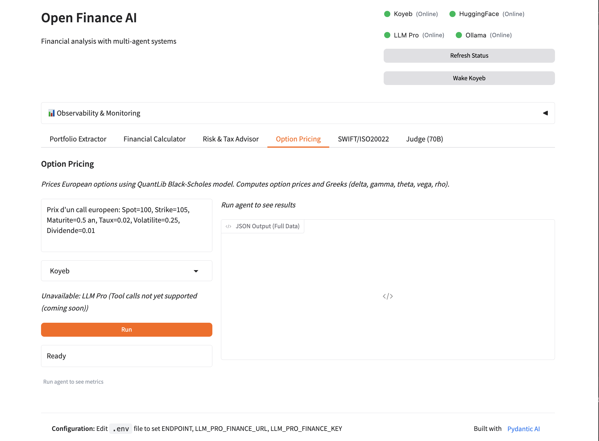

# Open Finance PydanticAI

[](https://ai.pydantic.dev/)
[](https://logfire.pydantic.dev/)
[](https://langfuse.com/)
[](https://koyeb.com/)
[](https://huggingface.co/spaces)
[](https://ollama.ai/)
[](LICENSE)

🇬🇧 [English version](README.md)

Projet de démonstration explorant les agents PydanticAI pour des tâches financières. Inclut tool calling, sorties structurées, et double observabilité via Langfuse et Logfire.

**Backend**: Nécessite un serveur LLM. Voir [Dragon-LLM/simple-open-finance-8B](https://github.com/Dragon-LLM/simple-open-finance-8B) pour le déploiement.

## À propos de PydanticAI

[PydanticAI](https://ai.pydantic.dev/) est un framework pour construire des agents IA avec sorties structurées type-safe, tool calling et mémoire. Il utilise les schémas Pydantic pour la validation et s'intègre avec les APIs compatibles OpenAI.

**Fonctionnalités principales :**
- Sorties structurées avec validation automatique
- Tool calling avec fonctions Python
- Gestion mémoire et contexte
- Définitions d'agents type-safe

**Exemple : Agent avec outils**

```python
from pydantic_ai import Agent, ModelSettings
from pydantic import BaseModel

# Définir un outil
def calculer_valeur_future(capital: float, taux: float, duree: float) -> str:
    """Calcule la valeur future avec intérêts composés."""
    import numpy_financial as npf
    return f"VF: {npf.fv(taux, duree, 0, -capital):,.2f}€"

# Définir sortie structurée
class Result(BaseModel):
    calculation_type: str
    result: float
    explanation: str

# Créer agent
agent = Agent(
    model,
    tools=[calculer_valeur_future],
    output_type=Result,
    system_prompt="Conseiller financier. Utilise les outils pour les calculs."
)

# Exécuter agent
result = await agent.run("50000€ à 4% sur 10 ans. Valeur future?")
```

Voir `examples/agent_2.py` pour une implémentation complète avec plusieurs outils financiers.

---

## Avertissement

Ce sont des exemples de démonstration à but pédagogique. Les logiciels financiers réels exigent des cadres de conformité, des pistes d'audit, une validation réglementaire et une ingénierie rigoureuse. À utiliser en connaissance de cause.

---

## Interface Gradio

Une interface web pour interagir avec tous les agents sans écrire de code.



```bash
python app/gradio_app.py
# Ouvrir http://localhost:7860
```

**Fonctionnalités :**
- Interface à onglets avec un onglet par agent
- Sélecteur d'endpoint pour basculer entre Koyeb, HuggingFace, Ollama ou LLM Pro Finance
- Monitoring santé serveur en temps réel avec réveil des services en veille
- Panneau d'observabilité avec toggles pour Langfuse et Logfire
- Suivi des appels d'outils avec métriques d'exécution

---

## Agents

Six agents de démonstration illustrant différents patterns PydanticAI :

| Agent | Tâche | Outils | Description |
|-------|-------|--------|-------------|
| **1** | Extraction de portefeuille | Schémas Pydantic | Extrait des données structurées de texte libre |
| **2** | Calculatrice financière | numpy-financial | Calcule VF, VAN, TRI, mensualités |
| **3** | Conseil risque & fiscal | Multi-agent | Orchestre analyste risque, conseiller fiscal, optimiseur |
| **4** | Pricing d'options | QuantLib | Black-Scholes et calcul des Greeks |
| **5** | SWIFT/ISO 20022 | Parsers custom | Conversion, validation, scoring risque AML |
| **6** | Juge | Modèle 70B | Évalue les sorties des autres agents |

Toutes les implémentations sont dans `examples/agent_*.py`.

---

## Modèles

| Endpoint | Modèle | Paramètres | Usage |
|----------|--------|------------|-------|
| Koyeb | Dragon LLM Open Finance Qwen 8B | 8B | Défaut pour tous les agents |
| HuggingFace Spaces | Dragon LLM Open Finance Qwen 8B | 8B | Alternative persistante |
| Ollama | Configurable | Variable | Inférence locale |
| LLM Pro Finance | Llama 70B | 70B | Évaluations agent Juge |

Tous les endpoints exposent des APIs compatibles OpenAI. Le modèle 8B gère le tool calling et les sorties structurées. Le modèle 70B fournit une évaluation de meilleure qualité pour l'agent Juge.

---

## Observabilité

L'observabilité est essentielle pour les applications LLM. Ce projet intègre deux plateformes :

**Logfire** (Pydantic)
- Instrumentation automatique de tous les agents PydanticAI
- Trace les runs d'agents, appels d'outils et générations LLM sans modification de code
- Intégration native avec l'écosystème Pydantic
- **[Logfire Evals](https://ai.pydantic.dev/evals/)** : Nouveau framework d'évaluation pour tests systématiques des agents

**Langfuse** (orienté LLM)
- Gestion détaillée des traces avec spans hiérarchiques
- Datasets d'évaluation et scoring
- Suivi des coûts et analytics d'usage

### Métriques Capturées

| Métrique | Logfire | Langfuse | Description |
|----------|---------|----------|-------------|
| Runs d'agents | ✅ | ✅ | Début/fin, durée, succès/échec |
| Appels d'outils | ✅ | ✅ | Outils appelés, arguments, résultats |
| Tokens utilisés | ✅ | ✅ | Tokens entrée/sortie par génération |
| Latence | ✅ | ✅ | Temps de réponse par span |
| Sorties structurées | ✅ | ✅ | Validation modèle Pydantic |
| Dépassement contexte | ✅ | — | Détecte quand limite de contexte dépassée |
| Anomalies tool calls | ✅ | — | Signale boucles d'outils excessives |
| Scores d'évaluation | ✅ | ✅ | Métriques de justesse, efficacité |

### Alertes & Tableaux de Bord

Avec Logfire, vous pouvez configurer des alertes pour :
- **Dépassement de contexte** : L'agent dépasse la fenêtre de contexte du modèle
- **Anomalies d'outils** : Patterns inhabituels d'appels (boucles, retries)
- **Latence élevée** : Temps de réponse dépassant les seuils

Voir `docs/logfire_setup.md` pour les requêtes SQL de configuration des alertes et dashboards.

### Configuration

```env
# Langfuse
ENABLE_LANGFUSE=true
LANGFUSE_PUBLIC_KEY=pk-lf-...
LANGFUSE_SECRET_KEY=sk-lf-...
LANGFUSE_HOST=https://cloud.langfuse.com

# Logfire
ENABLE_LOGFIRE=true
LOGFIRE_TOKEN=...  # ou authentification via: logfire auth
```

Les deux plateformes peuvent fonctionner simultanément. L'interface Gradio fournit des toggles pour activer ou désactiver chaque plateforme sans redémarrage.

---

## Installation

```bash
# Installation de base
pip install -e ".[dev]"

# Avec QuantLib pour le pricing d'options (Agent 4)
pip install -e ".[dev,quant]"
```

## Configuration

Créer un fichier `.env` :

```env
ENDPOINT=koyeb
API_KEY=not-needed
MAX_TOKENS=1500

# Optionnel: LLM Pro Finance pour l'agent Juge
LLM_PRO_FINANCE_KEY=votre-clé-api
LLM_PRO_FINANCE_URL=https://demo.llmprofinance.com

# Optionnel: Ollama local
OLLAMA_MODEL=dragon-llm
```

## Exécution

```bash
# Démarrer l'interface Gradio
python app/gradio_app.py

# Évaluations Logfire
python examples/run_logfire_evaluation.py --all --max-items 3

# Évaluations Langfuse
python examples/run_langfuse_evaluation.py --agents agent_1 agent_2 --max-items 3

# Pydantic Evals (framework officiel)
python examples/run_pydantic_evals.py --all --max-cases 3
```

---

## Structure du projet

```
app/
├── gradio_app.py          # Interface web
├── observability.py       # Handler unifié Langfuse + Logfire
├── config.py              # Configuration des endpoints
├── models.py              # Instanciation des modèles
├── langfuse_*.py          # Intégration Langfuse
├── logfire_*.py           # Intégration et métriques Logfire

examples/
├── agent_1.py             # Extraction de portefeuille
├── agent_2.py             # Calculs financiers
├── agent_3.py             # Workflow multi-agent risque/fiscal
├── agent_4.py             # Pricing d'options (QuantLib)
├── agent_5.py             # Conversion SWIFT/ISO 20022
├── agent_5_validator.py   # Validation des messages
├── agent_5_risk.py        # Évaluation risque AML
├── judge_agent.py         # Agent d'évaluation 70B
├── run_langfuse_evaluation.py
├── run_logfire_evaluation.py
└── run_pydantic_evals.py
```

---

## Références

- [PydanticAI](https://ai.pydantic.dev/) — Framework d'agents
- [Logfire](https://logfire.pydantic.dev/) — Observabilité Pydantic
- [Langfuse](https://langfuse.com/) — Traçage et évaluation LLM
- [Dragon-LLM/simple-open-finance-8B](https://github.com/Dragon-LLM/simple-open-finance-8B) — Déploiement serveur
- [vLLM](https://github.com/vllm-project/vllm) — Moteur d'inférence
- [numpy-financial](https://numpy.org/numpy-financial/) — Calculs financiers
- [QuantLib](https://www.quantlib.org/) — Pricing d'options

---

Licence MIT
